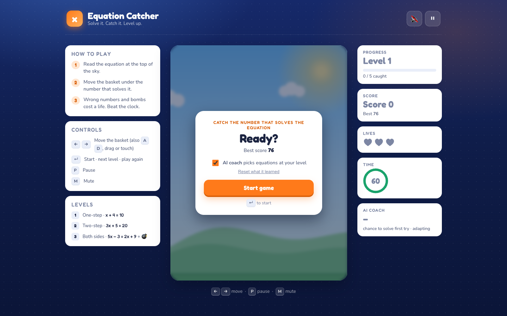
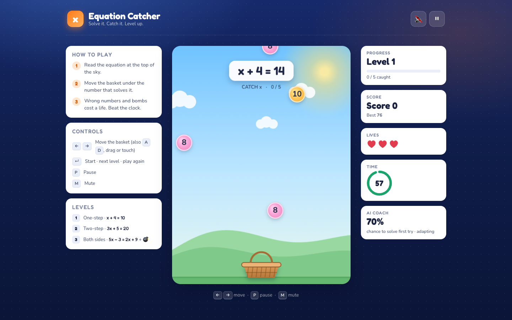
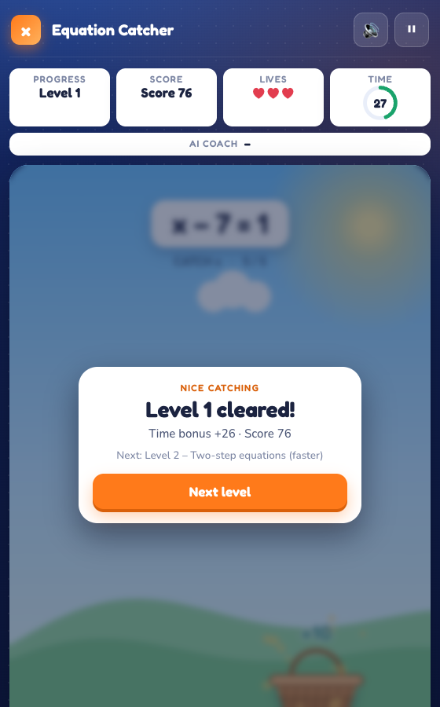
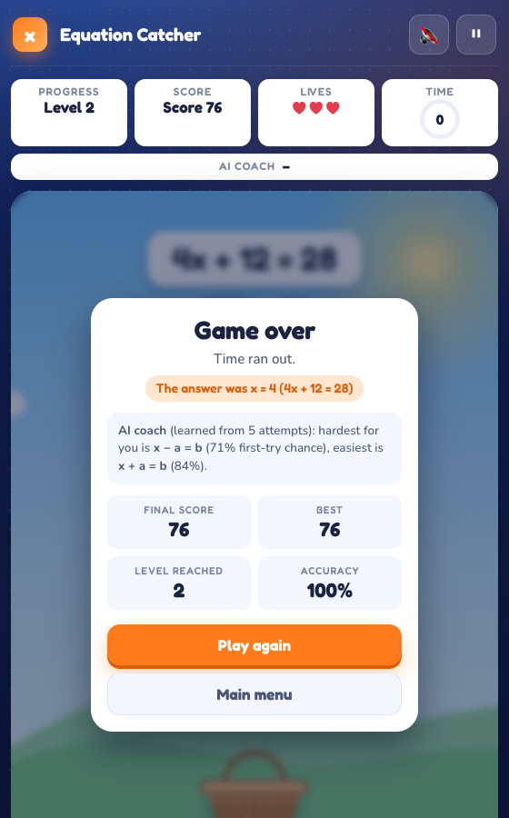
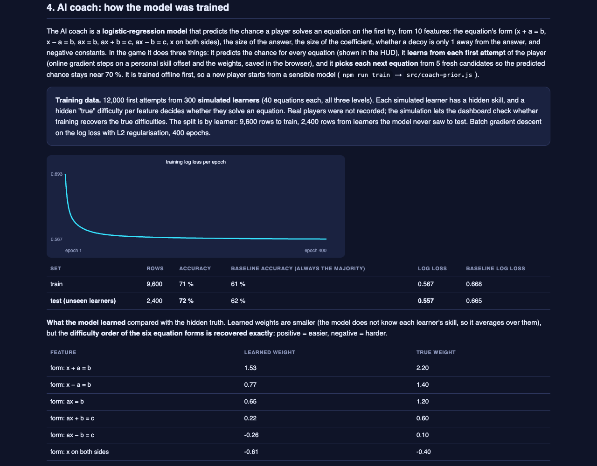

# Capstone Project Submission Report – Equation Catcher

Structure follows the 15-section *Project Submission Report template* in the IIT Patna B3 Capstone guidelines. A PDF of this report is in `docs/Equation_Catcher_Capstone_Submission.pdf` (rebuild with `npm run submission`).

## 1. Cover page

| | |
|---|---|
| **Learner name** | Reetika Kukreja |
| **Email id** | reetikakukreja12@gmail.com |
| **Mobile number** | 9694228896 |
| **Project title** | Equation Catcher – Vibe Coding Challenge: Build and Host Your Own Online Video Game |
| **Capstone track** | Project 2: Build and Host a Video Game |
| **Play online** | https://reetika-k.github.io/equation-catcher/ |
| **Game dashboard** | https://reetika-k.github.io/equation-catcher/reports/dashboard.html |
| **Repository** | https://github.com/Reetika-k/equation-catcher |

## 2. Project overview

Equation Catcher is a browser game built entirely with HTML, CSS and JavaScript using an AI coding assistant and incremental "vibe coding" prompts. The player catches the falling number that solves the equation shown at the top, across three levels of increasing difficulty, with lives, a timer, scoring, win and loss conditions, restart, sound and touch controls. The objective of the project is to show that an idea can be turned into a finished, tested, hosted software product by describing features clearly to an AI assistant, testing after every change and fixing what breaks.

## 3. Problem statement

Students in Classes 7 to 9 meet linear equations early and then practise them almost entirely on paper. Worksheets are slow, give no immediate feedback and reward copying a procedure rather than recognising the answer. Existing "maths games" are mostly quizzes with buttons, or arcade games with no learning content. So practice is either boring or pointless, and students stop doing it.

The target players are students aged 12 to 15 who can solve simple linear equations but need quick, repeated practice, plus casual players who enjoy short reflex games. They play on laptops at school or phones at home in three-to-five-minute sessions, so the game must load instantly, need no account, and work with a keyboard, a mouse or a thumb.

The builder's challenge is different: the capstone asks a non-programmer to produce a complete, hosted game with AI assistance. The game must be simple enough to finish reliably, yet contain everything the guidelines require: a clear objective, controls, scoring, challenges, three levels, win and loss conditions, restart, attractive visuals and online hosting. It must also be testable, because an untested game breaks in the demo.

The proposed solution is Equation Catcher. An equation appears at the top and numbers fall from the sky; the player moves a basket to catch the one that solves it. Every number looks identical, so the player must actually solve the equation, which is where the learning happens. Correct catches score points and bring the next equation; wrong numbers and bombs cost lives; a timer and rising speed add pressure; three levels move from one-step equations to the variable on both sides. The logic is separated from the drawing so it can be tested automatically, and the game is a static site hosted free on GitHub Pages.

## 4. Target users

- Students aged 12–15 practising linear equations (Class 7–9), on laptops or phones, in short sessions.
- Casual players who like "catch the falling objects" reflex games.
- Problem they face: practice that is slow, feedback-free and boring; existing maths games that are quizzes in disguise.

## 5. Proposed solution

A single-page canvas game with: an equation banner; falling number bubbles (correct answer and plausible decoys look identical); a basket controlled by keyboard, drag or touch buttons; scoring with a level multiplier and time bonus; three lives; a 60-second timer per level; three levels of different equation types and speeds, with bombs in the last; start, level-up, game-over and pause screens; synthesised sound with mute; a saved high score. No server, no account, no download.

## 6. Key features

1. Clear objective shown on the start screen with instructions
2. Controls: keyboard (arrows / A D), mouse or touch drag, on-screen buttons on phones
3. Scoring: +10 × level per correct catch, time bonus per level, saved high score
4. Challenges: wrong numbers and bombs cost lives, countdown timer, increasing fall speed and more decoys
5. Three levels: one-step → two-step → variable on both sides
6. Win (clear Level 3) and loss (no lives or no time) conditions with distinct screens
7. Restart from the game-over screen, pause/resume, mute
8. Visual design (UI/UX pass, `docs/DESIGN.md`): responsive game shell with help, play area and live stats; modal cards for every screen; timer ring, progress bar, hearts that react; sky with sun and hills, gradient number bubbles, woven basket that tilts; particles, screen shake, floating score text; Fredoka/Nunito type system; reduced-motion and keyboard support
9. Reproducible games via `?seed=` for testing and demos
10. Hosted as a static site (GitHub Pages)
11. **AI coach (machine learning):** a logistic-regression model trained offline on 9,600 attempts from simulated learners (72 % test accuracy on unseen learners vs a 62 % baseline) predicts each equation's first-try chance, learns online from the player's own first attempts, and chooses the next equation to keep that chance near 70 %; the game-over card names the player's hardest equation form

## 7. Solution architecture

```
Player input (keyboard / pointer / touch buttons)
  ↓
main.js  — game loop (requestAnimationFrame), input state, screens, effects, high score
  ↓ update(dt, input)                      ↓ events (catch, wrong, bomb, levelup, win, lose)
game.js  — pure game state: levels, spawning, movement, catch detection, lives, timer
  ↓ uses                                    ↓
equations.js — equation + decoy generator  audio.js — Web Audio sounds
coach.js — AI coach (predict · learn online · choose the next equation; weights from coach-prior.js, trained by scripts/train-coach.mjs)
rng.js — seedable random numbers           render.js — canvas drawing
  ↓
index.html / style.css — canvas, HUD, overlays, responsive layout
  ↓
GitHub Pages (static hosting)
```

The separation matters: `game.js` and `equations.js` have no DOM access, so 20 automated tests exercise scoring, lives, levels, timer, win/loss, restart and the AI coach (training, online learning, adaptive choice) without a browser; the browser play test then checks the real page.

## 8. Tools and technologies

| Category | Used |
|---|---|
| Development | AI coding assistant (vibe coding), VS Code, Node.js 25 for tests and the local server |
| Game technologies | HTML5 Canvas, CSS, JavaScript ES modules, Web Audio API, localStorage |
| Testing | `node:test` logic tests; headless Chrome driven over the DevTools Protocol for the play test |
| Hosting | GitHub Pages (static); Netlify/Vercel also possible |
| AI at runtime | AI coach: logistic regression in plain JavaScript, trained offline (`npm run train`) and updated online in the browser; no server or API, so hosting stays free and the game works offline |

## 9. Working prototype

- Local: `npm start` → http://localhost:8080
- Public URL: https://reetika-k.github.io/equation-catcher/ (game dashboard: https://reetika-k.github.io/equation-catcher/reports/dashboard.html)
- Demo flow: `docs/DEMO_SCRIPT.md`
- Screenshots below are from the live site (2026-10-24); more in `docs/screenshots/`.


*Start screen: how to play, controls, the three levels, and the AI coach switch.*


*Playing Level 1: catch the number that solves x + 4 = 14. The AI coach panel shows the predicted chance of solving it on the first try.*


*Level cleared, with the time bonus (phone layout).*


*Game over: the missed answer, the score, and what the AI coach learned about which equation form is hardest for this player.*


*Game dashboard: how the AI coach was trained (loss curve, accuracy on unseen learners vs the baseline, learned vs true difficulty).*

## 10. Prompts used

All prompts to the coding assistant, with what they produced and what broke, are in `docs/VIBE_CODING.md`. The pattern follows the PDF's advice: concept first, then logic, then one feature at a time, testing after each. Debugging prompts describe the exact symptom ("`npm test` reports one failing item named *tests*") rather than asking for a rewrite.

## 11. Testing report

Two layers, both actually executed: 20 logic tests (`npm test`, all pass; 9 of them for the AI coach) and a browser play test, now 20 checks including the AI coach's HUD prediction and what it saved after a game (18 checks before the coach) (`npm run test:e2e`; run 1: 17/18 with a timing race in the test itself, run 2: 18/18; after the redesign run 3: 17/18 from an outdated test expectation, run 4: 18/18) that starts a seeded game, presses the controls, auto-plays Level 1, and checks level-up, pause, mute, both loss conditions, restart, the saved high score and the phone layout. The scenario table with expected and actual results, and the bugs found, are in `docs/TESTING.md`.

## 12. Challenges and solutions

| Challenge | What happened | Solution |
|---|---|---|
| Test runner did not find tests | `node --test tests/` reported one failing item named "tests" on Node 25 | Name the test file explicitly in `package.json` |
| Files written to the wrong project | Two commands ran in parallel and the shell's working directory changed between them; five game files landed in the tutor folder and its test script was overwritten | Moved the files, restored both scripts, re-ran both suites; use absolute paths in scripted edits |
| Decoys must look plausible but never be correct | Random wrong numbers could accidentally solve the equation | Every equation carries a `check(v)` function; decoys are filtered through it, and a test proves no decoy ever satisfies its equation across 600 generated equations |
| Correct answer might never fall | Pure random spawning could starve the player | Spawner guarantees a correct number within three spawns when none is on screen; tested |
| ES modules do not run from `file://` | Double-clicking `index.html` shows nothing | Tiny dependency-free static server (`npm start`); documented; GitHub Pages serves over HTTP anyway |

| Play test flaked once | The test read the HUD label before the next animation frame updated it after a level change | The check now waits for the frame; run 2 passed 18/18 |
| First version looked like a phone emulator on desktop | A 480 px column in empty space, orphaned buttons, text-only game-over, no answer shown | UI/UX redesign (`docs/DESIGN.md`): responsive shell, stat panel with timer ring, modal cards with the missed answer and accuracy; play test re-run 18/18 after one expectation update |

## 13. Final outcome

A complete, tested browser game meeting every expected outcome in the PDF (objective, controls, scoring, challenges, three levels, win/loss, restart, visuals, instructions, hosting configuration), built with incremental AI-assisted prompts and verified by automated logic and browser tests. An AI coach adds machine learning: a model trained offline, evaluated on unseen learners, and personalised online for each player. Key learnings: separate logic from drawing so it can be tested; make randomness seedable; test after every step; describe bugs precisely to the assistant.

## 14. Future enhancements

Leaderboard (needs a small backend), power-ups (slow-motion, wider basket), achievements and badges, AI-generated word problems as a bonus level, a two-player split-screen mode, more equation types (brackets, fractions), a teacher mode that logs which equations were missed, and measuring the AI coach on real players (the current training data is simulated).

## 15. Project demo

- Demo script: `docs/DEMO_SCRIPT.md`
- Public URL: https://reetika-k.github.io/equation-catcher/
- Game dashboard: https://reetika-k.github.io/equation-catcher/reports/dashboard.html
- Repository: https://github.com/Reetika-k/equation-catcher
